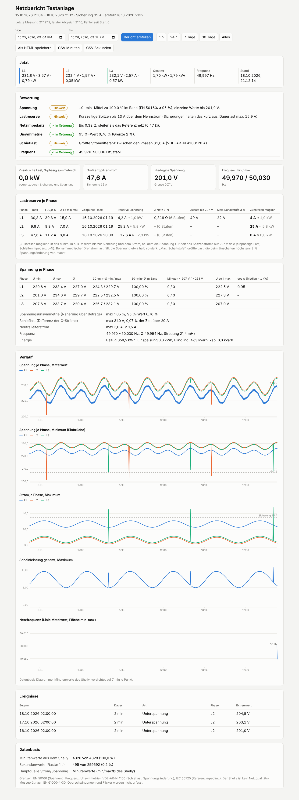

# Shelly-Netzanalyse für den Shelly Pro 3EM

Ein Dienst für einen Proxmox-LXC, der aus einem Shelly Pro 3EM alle Daten sammelt, die man für zwei Fragen
braucht:

1. **Wie viel Last darf noch an den Anschluss?** Lastreserve je Phase bis zur Vorsicherung des Messpunkts und bis zur
   Spannungsgrenze von 207 V.
2. **Wie stabil ist das Netz am Messpunkt?** Spannungsband, Einbrüche, Netzimpedanz, Unsymmetrie, Schieflast
   und Frequenz.

Den Bericht für einen beliebigen Zeitraum rufst du jederzeit im Browser ab.



## Installation auf Proxmox VE

Auf dem Proxmox-Host als root:

```bash
bash -c "$(curl -fsSL https://raw.githubusercontent.com/spapossen/shelly-netzanalyse/main/proxmox-lxc.sh)"
```

Das Skript fragt nach der IP des Shelly und dem Nennstrom der Vorsicherung des Messpunkts. Container-ID, Speicher,
Netzwerk (DHCP oder feste IP, optional VLAN), Größe und RAM sind sinnvoll vorbelegt. Danach erledigt es
Folgendes:

- lädt die aktuelle Debian-12-Vorlage,
- legt einen unprivilegierten LXC an (1 Kern, 512 MB RAM, 16 GB Disk, startet mit dem Host),
- aktualisiert ihn und installiert den Dienst,
- zeigt am Ende die Adresse des Berichts an, z. B. `http://192.168.1.60:8080/`.

Ohne Rückfragen, etwa für die Automatisierung:

```bash
SHELLY_IP=192.168.1.50 SICHERUNG=35 CTID=120 NETZ=192.168.1.60/24 GATEWAY=192.168.1.1 \
  bash -c "$(curl -fsSL https://raw.githubusercontent.com/spapossen/shelly-netzanalyse/main/proxmox-lxc.sh)"
```

Weitere Variablen: `CT_NAME`, `STORAGE`, `TEMPLATE_STORAGE`, `DISK_GB`, `RAM_MB`, `CORES`, `BRIDGE`, `VLAN`,
`DEBIAN_VERSION` (12 oder 13).

**Aktualisieren** (Daten und Konfiguration bleiben erhalten):

```bash
bash -c "$(curl -fsSL https://raw.githubusercontent.com/spapossen/shelly-netzanalyse/main/proxmox-lxc.sh)" -- --update 120
```

**Ohne Proxmox** auf einem beliebigen Debian- oder Ubuntu-System:

```bash
git clone https://github.com/spapossen/shelly-netzanalyse.git && cd shelly-netzanalyse
sudo bash install.sh 192.168.1.50 35      # IP des Shelly, Sicherung in A
```

### Voraussetzungen am Shelly

- feste IP bzw. DHCP-Reservierung,
- Zeitsynchronisation (SNTP) eingeschaltet, Firmware aktuell,
- Stromwandler am Hausanschluss auf allen drei Außenleitern,
- falls ein Passwort gesetzt ist: in `/etc/shelly-monitor/config.ini` unter `[shelly] passwort` eintragen.

## Was der Dienst macht

- **Historie aus dem Shelly-Speicher:** Beim Start und danach alle 15 Minuten lädt er die 1-Minuten-Werte
  (bis etwa 60 Tage zurück). Je Phase sind das min/max/Ø von Spannung und Strom, min/max von Wirk- und
  Scheinleistung, die Energien (Bezug, Einspeisung, Blind induktiv/kapazitiv) und der Neutralleiterstrom.
  Lücken, etwa nach einem Neustart, füllt der Dienst so automatisch nach.
- **Sekundenwerte ab dem Start:** Jede Sekunde fragt er alle Momentanwerte ab (`EM.GetStatus`): U, I, P, S,
  cos φ und Frequenz je Phase. Laststufen erkennt er dabei sofort und speichert sie für die Impedanzschätzung.
- **Speicher:** SQLite unter `/var/lib/shelly-monitor/daten.db`. Sekundenwerte belegen etwa 11–15 MB je Tag
  und werden standardmäßig nach 180 Tagen gelöscht. Die Minutenwerte bleiben unbegrenzt erhalten.

## Der Bericht

Unter `http://<container-ip>:8080/` gibt es:

- **Zeitraum:** frei wählbar oder per Knopf 1 h, 24 h, 7 Tage, 30 Tage, Alles,
- **Live-Werte** je Phase, alle 2 Sekunden aktualisiert,
- **Bewertung mit Ampel** und die Abschnitte aus der folgenden Tabelle,
- **Diagramme** mit Werten beim Darüberfahren: Spannung Ø und Minimum, Strom-Maximum mit Sicherungslinie,
  Scheinleistung, Frequenz,
- **Downloads:** Bericht als eigenständige HTML-Datei, Minuten- und Sekundenwerte als CSV.

| Abschnitt | Inhalt | Grenze |
|---|---|---|
| Lastreserve | Spitzenstrom, 15-min-Mittel, Reserve bis zur Sicherung, zusätzlich möglicher Strom je Phase | Sicherung, 207 V |
| Netzimpedanz | Z ≈ −ΔU/ΔI aus Laststufen; daraus Spannungsfall und größte Schaltstufe | IEC 60725: 0,47 Ω, ΔU ≤ 3 % |
| Spannung | min/max, 10-min-Mittel im Band, Minuten außerhalb, Spannung beim Spitzenstrom | EN 50160: 207–253 V |
| Unsymmetrie, Schieflast | Spannungsunsymmetrie (Näherung), Stromdifferenz der Phasen, Neutralleiter | 2 %, VDE-AR-N 4100: 20 A |
| Frequenz | min/max, Streuung, Sekunden außerhalb 49,8–50,2 Hz und 49,5–50,5 Hz | EN 50160 |
| Ereignisse | Zeiträume mit Unter- oder Überspannung bzw. Frequenzabweichung | |

**Zusätzlich möglicher Strom** ist das Minimum aus der Reserve bis zur Sicherung und dem Strom, bei dem die
Spannung zum Zeitpunkt des Spitzenstroms auf 207 V fiele. Gerechnet wird für eine einphasige Last mit der
Schleifenimpedanz L–N. Bei symmetrischer Drehstromlast fällt die Spannung etwa halb so stark.

**Neutralleiter und Sternpunkt (berechnet):** Der Pro 3EM misst den Neutralleiter nicht. Der Dienst rechnet ihn
deshalb aus den drei Außenleiterströmen und ihren Phasenwinkeln (nur Grundschwingung, also eine Untergrenze).
Aus den drei Spannungen L–N bestimmt er außerdem, wie weit sich der Sternpunkt verschiebt. Das Streudiagramm
„Verschiebung über N-Strom“ und eine Kopplungsmatrix ΔU/ΔI liefern Schätzwerte für die Widerstände von
Neutral- und Außenleiter. Das gilt rückwirkend für die ganze Historie: Vorhandene Daten werden nach einem Update
einmalig nachberechnet.

**Zuleitung:** Liegt der Messpunkt hinter einer langen Zuleitung, trage in der Konfiguration unter `[zuleitung]`
Länge, Querschnitt und Material ein. Der Bericht vergleicht dann die gemessenen Impedanzen mit den
Leitungswiderständen und zeigt, ob die Zuleitung den Spannungsfall erklärt oder ob mehr dahintersteckt
(z. B. eine schlechte Klemme).

**Fachkraft-Ansicht** (Knopf „Fachkraft-Ansicht“ bzw. `?modus=fach`): Rohdaten ohne Ampel und ohne Deutung,
für die Beurteilung durch eine Elektrofachkraft. Sie enthält:

- Messpunkt, Gerät und Datenbasis,
- Perzentile aller Größen je Phase und die 10-min-Statistik nach EN 50160,
- Kopplungsmatrix ΔU/ΔI und Impedanz aus Laststufen,
- erwartete Werte der Zuleitung,
- Klassen von N-Strom und Sternpunktverschiebung,
- die Minuten mit der niedrigsten und höchsten Spannung (alle Phasen gleichzeitig),
- Tagesprofil, Liste der Grenzwertverletzungen und offengelegte Methoden.

Als HTML-Datei speicherbar, die Daten gibt es auch als JSON unter `api/fachdaten`.

**Netzimpedanz:** Sie braucht klare Laststufen ab 8 A auf einer Phase, während die anderen Phasen ruhig
bleiben. Fehlen sie, schalte bei laufendem Dienst ein paar Mal eine große Last ein und aus, etwa einen
Wasserkocher oder ein Heizgerät.

Dieselben Daten gibt es als JSON unter `api/bericht`, `api/fachdaten`, `api/verlauf`, `api/live` und `api/status`, mit den
Parametern `von`/`bis` (z. B. `2026-10-18T08:00`) oder `zeitraum=1h|24h|7d|30d|alles`.

## Betrieb

```bash
pct exec 120 -- nano /etc/shelly-monitor/config.ini        # Sicherung, Name, Port, Web-Passwort, Aufbewahrung
pct exec 120 -- systemctl restart shelly-monitor
pct exec 120 -- journalctl -u shelly-monitor -f            # Log
pct exec 120 -- sqlite3 /var/lib/shelly-monitor/daten.db   # Rohdaten: Tabellen minute, sekunde, stufe
```

Die Weboberfläche ist ohne Anmeldung erreichbar. Wer sie schützen will, setzt in der Konfiguration unter
`[web]` ein Passwort (HTTP Basic Auth). Sie gehört ins Heimnetz und nicht ungeschützt ins Internet.

## Entwicklung

```bash
python3 -m unittest discover -s tests -v                   # Tests mit simuliertem Shelly
python3 tests/fake_shelly.py 8098 &                        # Simulierter Shelly zum Ausprobieren
printf '[shelly]\nhost = 127.0.0.1:8098\n[speicher]\ndatenbank = test.db\n[web]\nport = 8099\n' > test.ini
python3 shelly_monitor.py --config test.ini                # Bericht unter http://127.0.0.1:8099/
```

Abhängigkeiten: Python ≥ 3.11 und `requests`. Mehr braucht es nicht.

## Grenzen

Der Shelly ist kein Netzqualitäts-Messgerät nach EN 61000-4-30 Klasse A.

- Oberschwingungen (THD) und Flicker misst er nicht.
- Einbrüche unter einer Sekunde sind nur über die min/max-Werte der Minutenhistorie sichtbar.
- Die Unsymmetrie wird ohne Phasenwinkel genähert.

Eine verbindliche Aussage zur Anschlussleistung trifft der Netzbetreiber; der Bericht ist die Grundlage für
das Gespräch.

## Lizenz

MIT, siehe [LICENSE](LICENSE).
